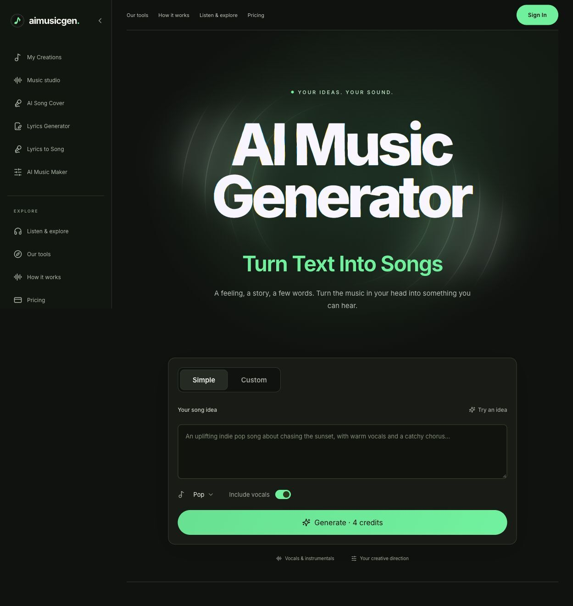
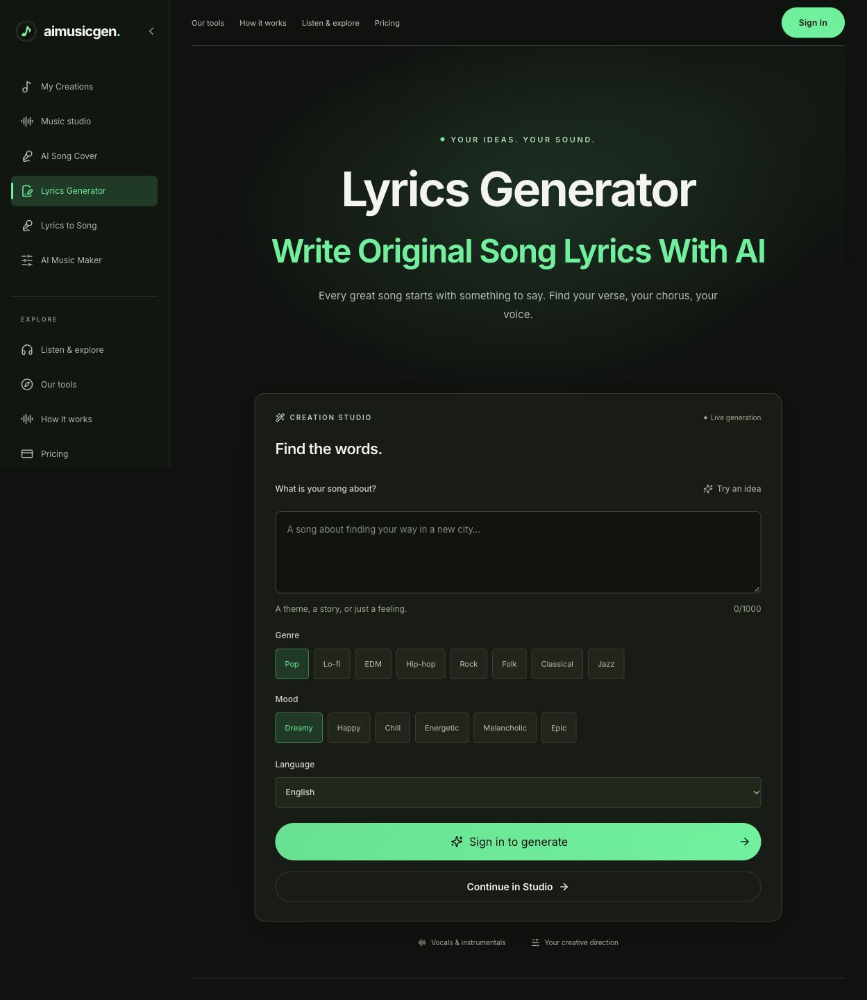
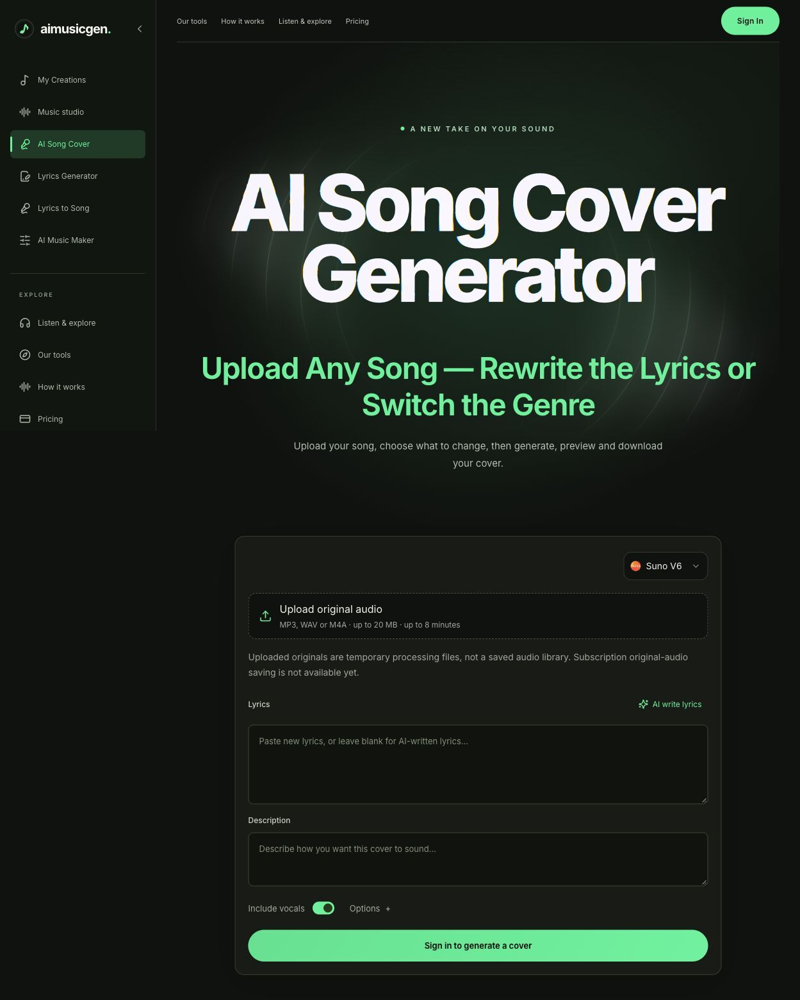

# Aimusicgen

Turn ideas and lyrics into AI-generated songs.

[Visit Aimusicgen](https://aimusicgen.app/) · [Pricing](https://aimusicgen.app/pricing) · [Terms](https://aimusicgen.app/terms)

This repository is a product introduction and usage guide for the hosted Aimusicgen service. It contains public screenshots and branding assets; the website source code and model weights are not distributed here.

## What you can create

- **Songs from text:** describe a musical idea and choose a genre, mood, length, and vocal direction.
- **Songs from lyrics:** bring your own lyrics and generate a song with vocals, or explore instrumental music.
- **Editable lyrics:** draft lyrics before making a track. Lyrics generation does not deduct site credits.
- **AI song covers:** explore a different version of a recording you own or have permission to adapt. The upload tool accepts MP3, WAV, and M4A files up to 20 MB and 8 minutes.
- **A personal collection:** listen, download, favorite tracks, and optionally enable a sharing link for a selected song. Songs are private by default.

## Getting started

1. Open [aimusicgen.app](https://aimusicgen.app/) and sign in. Generation requires an account; public samples can be played before signing in.
2. Choose the music generator, lyrics generator, or AI Song Cover tool.
3. For a new song, enter a prompt or your own lyrics and adjust the available music settings. For a cover, upload audio you have the rights to use.
4. Review the credit cost shown before generating. One default song-generation request costs 4 credits; the number of outputs can vary.
5. Find the result in My Creations. Listen, download the files you want to keep, or enable a link to share a selected track.

Prompt example: “A warm acoustic folk song about a quiet morning by the sea, gentle vocals, relaxed mood.” Add your own lyrics if you want more control over the words.

## Who it is for

Aimusicgen can help songwriters explore demos, content creators develop musical ideas, and hobbyists experiment with lyrics, genres, and arrangements. Check the usage rights below before using a track commercially.

## Free credits and paid use

Free accounts receive **4 credits once per UTC day** when they sign in or return to the service. That is enough for one default song-generation request. Unused daily credits expire at UTC midnight and do not accumulate. Exhausting the daily credits does not trigger another grant that day.

Paid subscriptions and one-time credit packs provide additional usage. Monthly subscriptions start at **US$14.90 for Basic**. See the [current pricing page](https://aimusicgen.app/pricing) for plan details and prices.

**Free accounts do not include commercial-use rights.** Paid subscriptions and credit-pack purchases include commercial use of generated music and lyrics under the [terms](https://aimusicgen.app/terms), subject to rights in any material you supply. Public sample tracks are excluded. Do not assume that an output is unique or that a copyright or non-infringement guarantee applies.

## Save your work

Generated-song availability depends on the plan:

| Plan | Song storage |
| --- | --- |
| Free | 7 days |
| Basic | 30 days |
| Standard | 180 days |
| Pro | 365 days |

Download important tracks before expiry. Extra credit purchases do not extend storage. Uploaded original audio is held temporarily for processing; a reusable original-audio library is not currently available.

## Screenshots

### Music generator

### Lyrics generator

### AI Song Cover

## Links and contact

- Website: [https://aimusicgen.app/](https://aimusicgen.app/)
- Pricing: [Plans and credits](https://aimusicgen.app/pricing)
- Contact: [contact@aimusicgen.app](mailto:contact@aimusicgen.app)

Product details checked on October 16, 2026. The live service, pricing page, and terms are the references for current availability and conditions.
